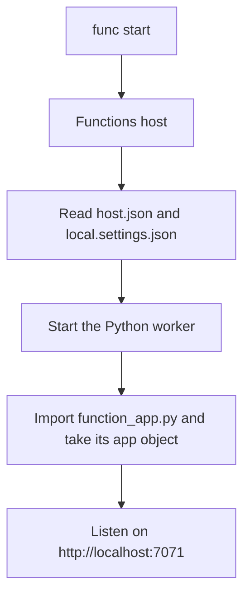
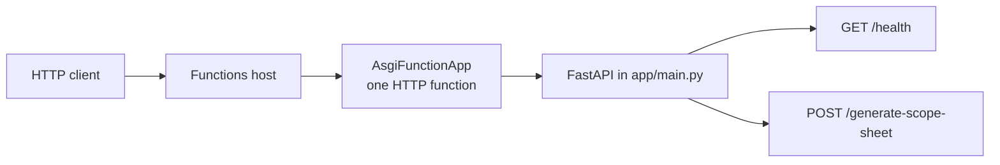
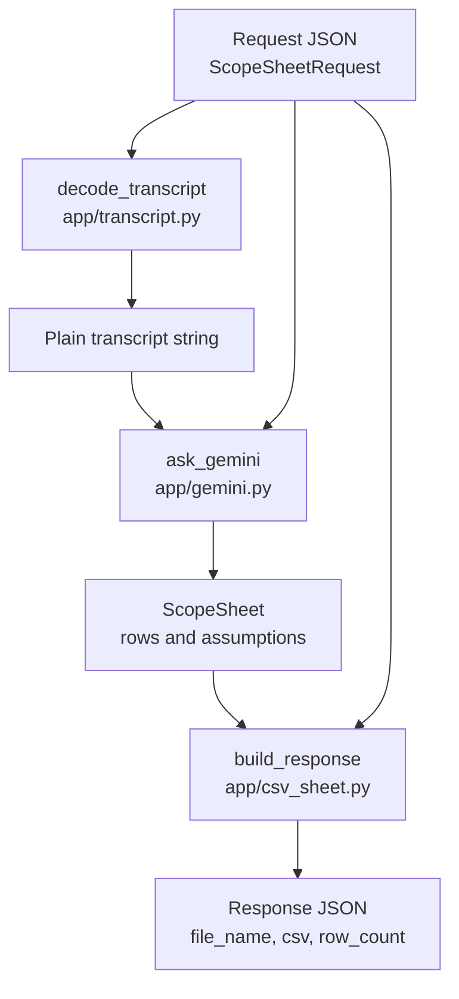
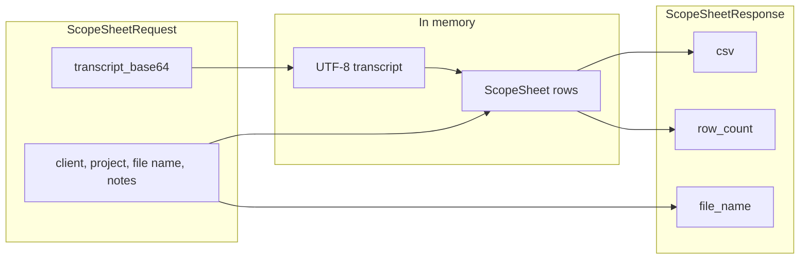

# Document-Generator

An Azure Functions app that turns a scope-call transcript into a scope sheet. The caller sends the transcript as base64 text. The app returns a plain CSV string in JSON.

The app runs locally with Azure Functions Core Tools (`func start`) and can later be published as the same project. This document covers two separate things:

1. **App pipeline.** How the process starts, what `AsgiFunctionApp` is, and how a URL reaches a Python function.
2. **Data pipeline.** How the request body is transformed into a CSV, and which file does each step.

## Layout

```text
Document-Generator/
  function_app.py     Functions entry. Wires FastAPI to the host.
  host.json           Host settings: timeout and URL prefix.
  local.settings.json Local secrets and settings. Not committed.
  requirements.txt    Python packages.
  app/
    main.py           FastAPI app and the two routes.
    models.py         Request, model output, and response shapes.
    transcript.py     Base64 text to a plain string.
    gemini.py         Prompt, Gemini call, row grouping.
    csv_sheet.py      Rows to CSV text and a file name.
```

`models.py` does not transform data. The other files import those classes so each step agrees on the same fields.

## App pipeline

This section is about the process that listens for HTTP. It is not about the transcript or the CSV.

### What starts

Azure Functions Core Tools (`func`) is the local host. From this folder:

```powershell
func start
```

The host reads `host.json` and `local.settings.json`, starts a Python worker, and imports `function_app.py`. The name `app` in that file is the object the host looks for. The worker then serves HTTP on port 7071.

`host.json` sets two things that change the addresses:

- `functionTimeout` is `00:10:00`, so one request may run for 10 minutes.
- `extensions.http.routePrefix` is `""`, so routes are not prefixed with `/api`.

A call is therefore `http://localhost:7071/generate-scope-sheet`, not `http://localhost:7071/api/generate-scope-sheet`.



### One HTTP function, then FastAPI routes

`function_app.py` does not define `/health` or `/generate-scope-sheet`. It builds one Azure Function:

```python
app = func.AsgiFunctionApp(
    app=fastapi_app,
    http_auth_level=func.AuthLevel.ANONYMOUS,
)
```

`AsgiFunctionApp` is the adapter between the Functions host and a Python web app. The host receives the raw HTTP request. FastAPI expects a server that speaks ASGI, the standard interface for async Python web apps. `AsgiFunctionApp` translates the host request into an ASGI call, FastAPI handles it, and the adapter translates the reply back into the host's HTTP response.

That adapter is a single HTTP-triggered function with a catch-all route. FastAPI, created in `app/main.py`, then chooses the Python function from the path and method.



`AuthLevel.ANONYMOUS` means the host does not require a function key. Any caller who can reach the URL can call both routes.

### How a route is chosen

| Request | FastAPI function | What it returns |
| --- | --- | --- |
| `GET /health` | `health` | `{"status": "ok"}` |
| `POST /generate-scope-sheet` | `generate_scope_sheet` | `ScopeSheetResponse` JSON |
| Anything else | FastAPI's default | 404 |
| `POST` body that does not match `ScopeSheetRequest` | FastAPI validation | 422 |

`generate_scope_sheet` does not contain the processing steps itself. It calls three functions and maps their errors:

| Exception | HTTP status | When |
| --- | --- | --- |
| `ValueError` | 400 | The transcript base64 cannot be decoded, or the text is empty. |
| `RuntimeError` | 502 | The Gemini key is missing, or Gemini does not return usable rows. |

## Data pipeline

This section is about the body of `POST /generate-scope-sheet`. `GET /health` does not enter this pipeline.



### 1. Request JSON

FastAPI reads the body into `ScopeSheetRequest` before `generate_scope_sheet` runs.

| Field | Required | Role later |
| --- | --- | --- |
| `transcript_base64` | Yes | Decoded into the transcript text. |
| `file_name` | Yes | Passed to the model as the source file name. Not used as the CSV file name. |
| `client_name` | Yes | Passed to the model, and used in the CSV file name. |
| `project_name` | Yes | Passed to the model, and used in the CSV file name. |
| `notes` | No | Passed to the model. Empty notes are sent as the word `None.` |

### 2. Base64 to text

`decode_transcript` in `app/transcript.py` returns a normal Python string.

1. Trim the input.
2. If the value is a data URL (`data:...;base64,....`), keep only the part after the comma.
3. Base64-decode the bytes and decode those bytes as UTF-8.
4. Trim again. An empty result is a `ValueError`.

Invalid base64 or non-UTF-8 bytes are also a `ValueError`. The route turns that into HTTP 400. Nothing is written to disk.

### 3. Text to structured rows

`ask_gemini` in `app/gemini.py` sends two texts to Gemini:

- A fixed system instruction, `PROMPT`. It tells the model to include only work the transcript supports, to keep one `business_process` name for related features, and to put unresolved questions in `assumptions`.
- A user message built from `client_name`, `project_name`, `file_name`, `notes`, and the decoded transcript.

The model name comes from the `GEMINI_MODEL` environment variable. If that variable is missing, the model is `gemini-3.5-flash-lite`. The API key comes from `GEMINI_API_KEY`. A missing key raises `RuntimeError` before any network call.

The call uses structured output. `response_mime_type` is `application/json`, and `response_schema` is the `ScopeSheet` class, so the model must return JSON with this shape:

```text
ScopeSheet
  rows: list of
    business_process: str
    feature: str
    description: str
  assumptions: list of str
```

`ScopeSheet.model_validate_json` parses `response.text`. A transport failure, an empty body, or JSON that does not match the class becomes `RuntimeError` (HTTP 502). A parsed sheet with no rows is also a `RuntimeError`.

`_group_rows` then reorders the rows. It keeps the first-seen order of `business_process`, and places every feature of that process together. Whitespace around a process name is stripped before grouping, so `"Sales"` and `"Sales "` share one group. Assumptions are stripped the same way, and blank assumptions are dropped.

### 4. Rows to CSV text

`build_response` in `app/csv_sheet.py` does not call Gemini again. It builds `ScopeSheetResponse` in memory.

`_csv_text` writes a CSV into a string:

1. Header row: `Business process`, `Feature`, `Description`.
2. One row per `ScopeRow`, in the grouped order.
3. If any assumptions remain: a blank row, a row whose first cell is `Assumptions and open questions`, then one row per assumption.

`_file_name` builds the download name from `client_name` and `project_name`. Any run of characters other than letters and digits becomes `_`. The result looks like `Contoso_Portal_scope_sheet.csv`. This name is a field in the JSON. The function does not create a file.

### 5. Response JSON

The route returns the `ScopeSheetResponse` object. FastAPI serializes it:

```json
{
  "file_name": "Contoso_Portal_scope_sheet.csv",
  "csv": "Business process,Feature,Description\r\nSales,Login,Users sign in.\r\n",
  "row_count": 1
}
```

`csv` is the whole file as text. `row_count` is the number of scope rows, not counting the header or the assumption lines.



## Settings the pipeline reads

The Functions host loads `local.settings.json` into environment variables when `func start` starts. The file is listed in `.gitignore`.

| Variable | Used by | If it is missing |
| --- | --- | --- |
| `GEMINI_API_KEY` | `ask_gemini` | HTTP 502. The route does not call Gemini. |
| `GEMINI_MODEL` | `ask_gemini` | Uses `gemini-3.5-flash-lite`. |
| `AzureWebJobsStorage` | The Functions host, not the CSV code | The host cannot start when this points at Azurite and Azurite is not running. |
| `FUNCTIONS_WORKER_RUNTIME` | The Functions host | Must be `python`. |

Changing `local.settings.json` or the Python files requires a new `func start`. The host reads settings at startup.
